# CSC 4360 - Homework 02: Message Board Vault Hunt

**Name:** Adi Tauqir (Undergraduate)  
**Course:** CSC 4360 - Mobile Application Development  
**Repository:** https://github.com/aditauqir/homework-02.git  
**Release APK:** `HW02_AdiTauqir.apk` (Root directory & `build/app/outputs/flutter-apk/app-release.apk`)

---

## Overview & Setup

How to get started:

1. **Clone the repo and get packages:**
   ```bash
   git clone https://github.com/aditauqir/homework-02.git
   cd homework-02
   flutter pub get
   ```

2. **Cloud & Platform Configuration:**
   - Android internet access is configured in `android/app/src/main/AndroidManifest.xml` via `<uses-permission android:name="android.permission.INTERNET" />` for release APK networking.
   - Firebase initialization runs behind a styled splash screen in `lib/screens/splash_screen.dart` using `lib/firebase_options.dart` connected to Firebase project `cw-02-mad`.
   - Firebase Authentication manages Email/Password identity via a dedicated `AuthService`.
   - Cloud Firestore Standard Native database stores private user profiles under `users/{uid}` and public board messages under `messages/{msgId}`.
   - Firestore security rules are deployed in `firestore.rules`.
   - Local emulator suite is configured in `firebase.json` (Auth on 9099, Firestore on 8080, UI on 4000).

3. **Run the App on Android (Pixel 6a):**
   Launch Android emulator or connect a device, then run:
   ```bash
   flutter run --release
   ```

4. **Run Static Analysis & Unit Tests:**
   ```bash
   flutter analyze
   flutter test
   ```

5. **Run Automated Security Rules Unit Tests (Spice #2):**
   ```bash
   firebase emulators:exec --only firestore "node rules_test/runner.js"
   ```

---

## Implemented Features

This app implements the complete Firebase message board architecture required by Homework 02:
- **Styled Splash Screen & Cloud Boot:** Shows an amber vault branding screen while Firebase initializes; if connection fails, displays a visible retry button instead of crashing.
- **Firebase Authentication (AuthService):** Dedicated service encapsulating registration, sign-in, sign-out, `currentUser`, and a stable `authStateChanges()` stream. Validates email formats and 6+ character passwords with friendly error translation (`FirebaseAuthException` handling).
- **Mandatory 5-Field Firestore User Record:** Upon registration, writes the required document to `users/{uid}` with `uid`, `firstName`, `lastName`, `role`, and authoritative `FieldValue.serverTimestamp()`. Guarded by `ProfileGate` to prevent stranded accounts if network hiccups occur.
- **Documented Data Model & Placement:** Public notices live in `messages/{msgId}` readable by any signed-in user; private profile records live in `users/{uid}` readable and writable only by the owning UID (`request.auth.uid == uid`).
- **BoardService & Realtime Live Stream:** Encapsulates all Firestore operations behind typed methods so UI widgets never touch raw Firestore calls. Board view subscribes to `snapshots()` ordered oldest to newest, updating instantaneously across devices without manual refresh.
- **Owner-Guarded CRUD Operations:** Users can create messages, view the live board, edit their own text (stamping `editedAt` via server timestamp), and delete their own notices. Non-owned messages hide action buttons in the UI, and database rules enforce it against raw API tampering.
- **Security Rules Enforcement:** Deployed in `firestore.rules`, checking author UID ownership on create (`request.resource.data.authorUid == request.auth.uid`), update (`resource.data.authorUid == request.auth.uid`), and delete. Signed-out reads and cross-UID writes return `PERMISSION_DENIED`.
- **Main Spice · Release Readiness Gate:** Tested on the exact release APK `HW02_AdiTauqir.apk` installed on Android Pixel 6a (emulator-5554), confirming launch, auth, 5-field profile, CRUD cycle, rules denials, and persistence across app kill and relaunch.
- **Spice #1 · Emulator Explorer:** Firebase local emulator suite workflow configured with zero production footprint, verified via emulator execution and seeding scripts.
- **Spice #2 · Rules Unit Tester:** 5 automated mocha/node unit tests running against the local Firestore emulator with `@firebase/rules-unit-testing`, proving signed-out read denials, cross-UID update/delete denials, forged author denials, and owner CRUD success.
- **Spice #4 · Idempotent Alchemist:** Uses Firestore transactions on deterministic IDs (`authorUid_idempotencyKey`) inside `postMessageIdempotent()`. Simultaneous double-submits create exactly one message document.

---

## Verification Results

| Test | Action & Expected Path | Observed Result | Status |
| :--- | :--- | :--- | :---: |
| **T01** | **Splash & Initialization** | Launch app; show splash while Firebase initializes | Splash renders cleanly with vault logo, spinner, and transitions to AuthGate. | **Pass** |
| **T02** | **Session Persistence** | Force-stop app and relaunch from system launcher | Auth state restored via `authStateChanges()`; bypasses login directly to board. | **Pass** |
| **T03** | **Input Validation** | Submit empty fields and invalid email format | Form validation blocks submit; shows "Enter an email address" and password errors. | **Pass** |
| **T04** | **Auth Error Handling** | Sign in with non-existent or wrong password | Friendly SnackBar displayed ("Invalid email or password"); raw exceptions suppressed. | **Pass** |
| **T05** | **User Registration** | Register with First/Last Name, Role, Email, Password | Account created; `users/{uid}` written with all 5 required fields; routes to board. | **Pass** |
| **T06** | **Empty Board State** | Open board with zero documents | Intentional empty state renders with vault notice and encouragement to post first. | **Pass** |
| **T07** | **Live Stream Posting** | Post a message from composer | Message created with server timestamp; immediately appears via `snapshots()` stream. | **Pass** |
| **T08** | **Multi-User Realtime** | Post as User B and inspect User A posts | User B sees User A's posts live without refresh; User A's edit/delete buttons hidden. | **Pass** |
| **T09** | **Message Update (CRUD)** | Edit own message text in dialog | Text updates; `(edited)` indicator and server timestamp reflect live change. | **Pass** |
| **T10** | **Message Delete (CRUD)** | Delete message 1 while message 2 exists | Confirmation dialog appears; message 1 removed; message 2 remains intact. | **Pass** |
| **T11** | **Forged Author Rule Denial** | Inject write with forged author UID | Rejected by Firestore security rules (`permission-denied`); displayed in in-app log. | **Pass** |
| **T12** | **Cross-UID Edit Denial** | Attempt to update foreign document ID | Rejected by Firestore rules (`PERMISSION_DENIED: Missing or insufficient permissions`). | **Pass** |
| **T13** | **Idempotent Alchemist (Spice 4)** | Fire 2 concurrent posts with same nonce | First write commits; duplicate write aborts in transaction; exactly 1 doc created. | **Pass** |
| **T14** | **Rules Unit Tester (Spice 2)** | Run automated rules suite against emulator | 5 out of 5 tests pass (`rules_test/runner.js` with `@firebase/rules-unit-testing`). | **Pass** |

---

## Screenshots

| Screenshot | Description | Preview |
| :--- | :--- | :---: |
| **`t01_splash_or_login.png`** | App launch and initial Sign In screen with Firebase Authentication. | 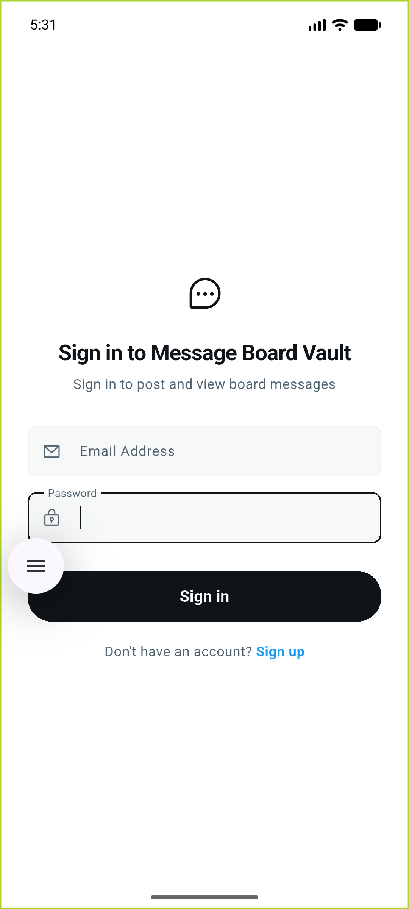 |
| **`t03_auth_validation_error.png`** | Form validation catching empty fields with inline error hints. | 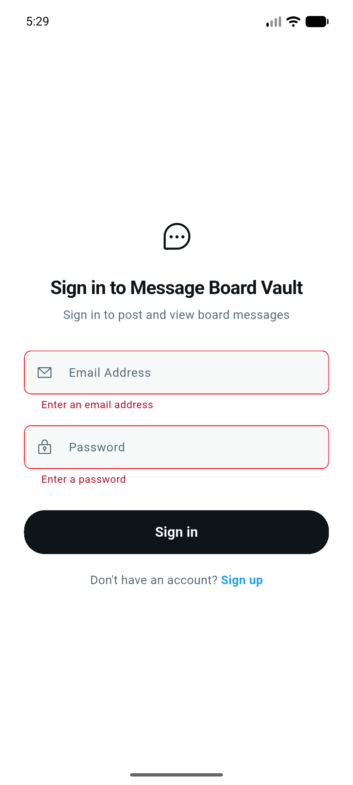 |
| **`t03_invalid_signin_error.png`** | Handled `FirebaseAuthException` showing friendly credential warning. | 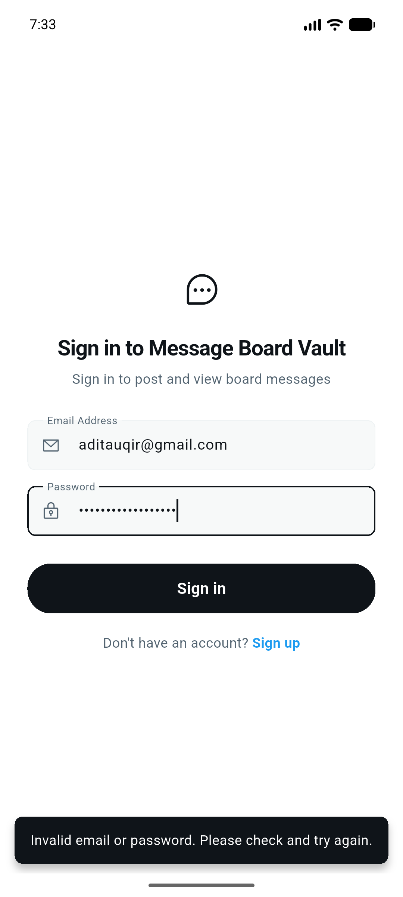 |
| **`t04_auth_register_screen.png`** | Registration form capturing First Name, Last Name, Role, and credentials. | 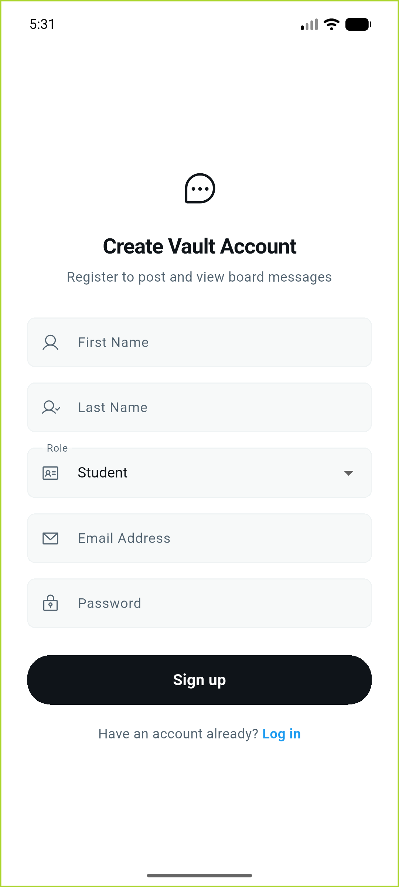 |
| **`t06_board_empty_state.png`** | Intentional empty vault board state prior to posting notices. | 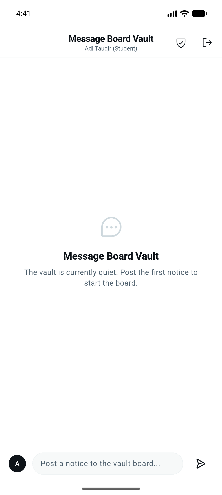 |
| **`t07_board_live_stream.png`** | Real-time live board displaying timestamped messages via `snapshots()`. | 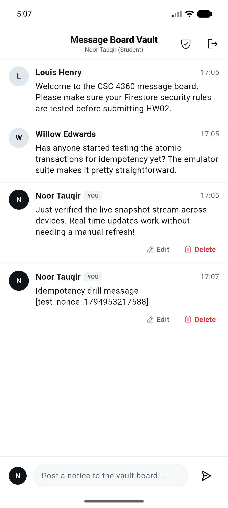 |
| **`t07_multi_user_stream_proof.png`** | Cross-user stream view: own posts have edit/delete; foreign posts protected. | 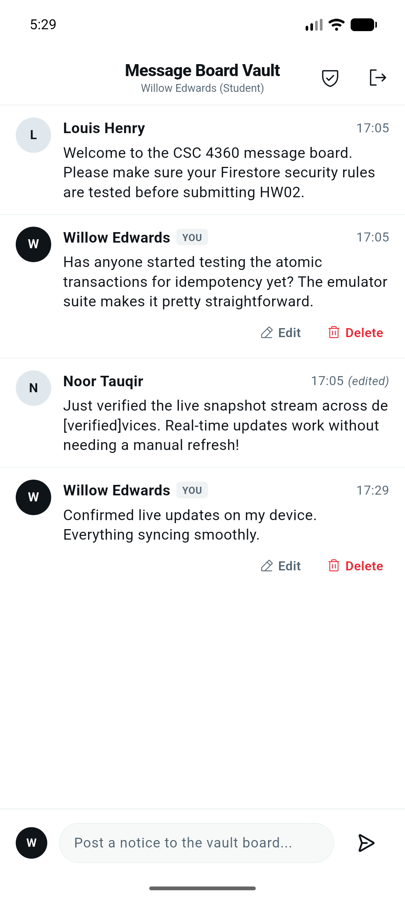 |
| **`t08_edit_dialog.png`** | Message Edit dialog with pre-filled text and validation. | 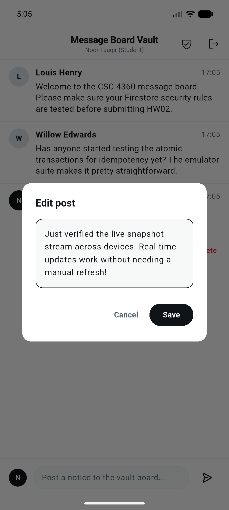 |
| **`t08_message_updated.png`** | Updated message rendering live with `(edited)` tag and new timestamp. | 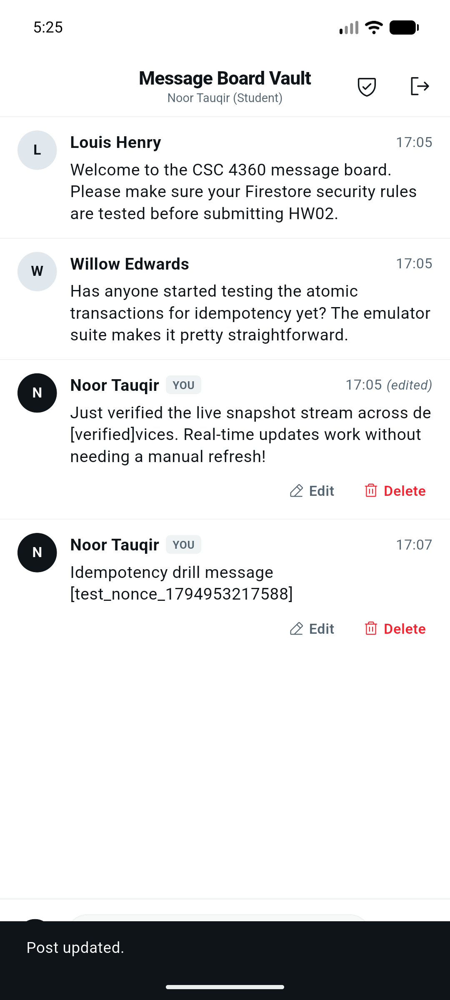 |
| **`t09_delete_dialog.png`** | Confirmation dialog preventing accidental document deletions. | 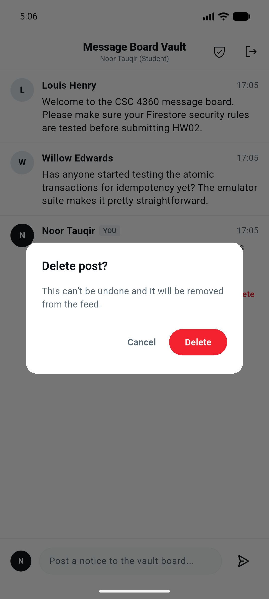 |
| **`t09_message_deleted.png`** | Real-time deletion confirmed; remaining documents untouched. | 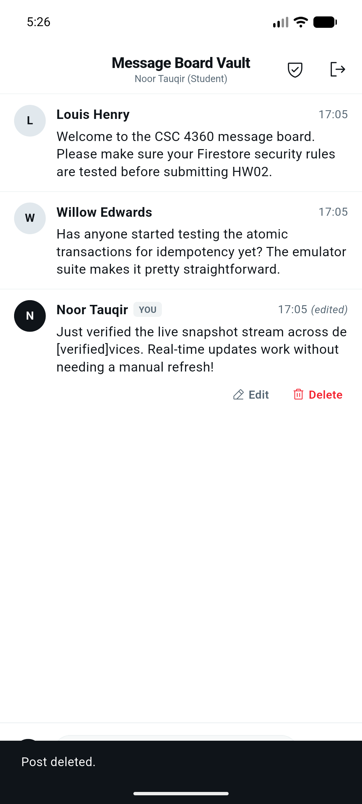 |
| **`t10_rules_forged_denial.png`** | In-app probe triggering Firestore security rule denial on forged UID. | 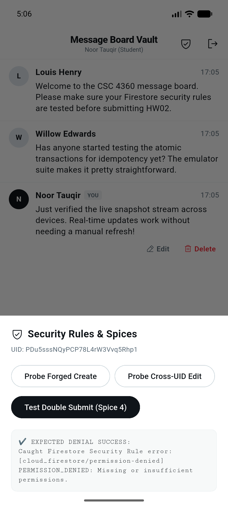 |
| **`t11_rules_cross_uid_denial.png`** | In-app probe triggering rule denial on cross-UID message edit. | 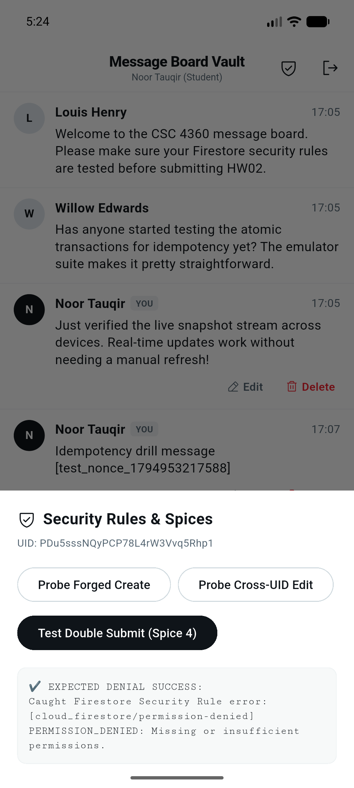 |
| **`t12_spice4_idempotent_double_submit.png`** | Spice #4 idempotency test proving transaction deduplicates writes. | 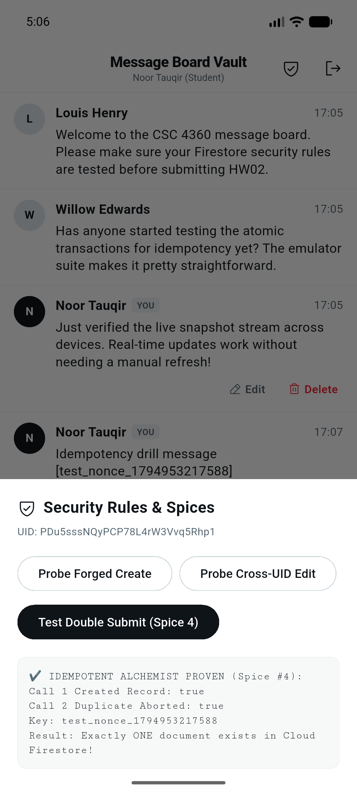 |
| **`t01_session_restored_relaunch.png`** | Kill-and-relaunch test verifying session and Firestore state restored. | 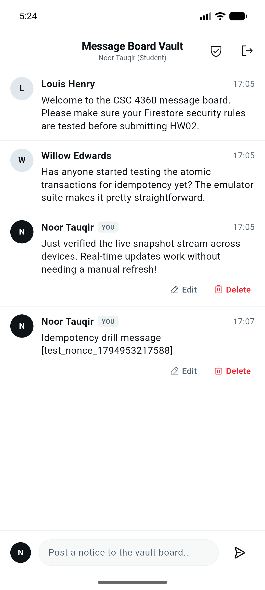 |
| **`t02_signout_landing.png`** | Secure sign-out returning user to Auth screen with board hidden. | 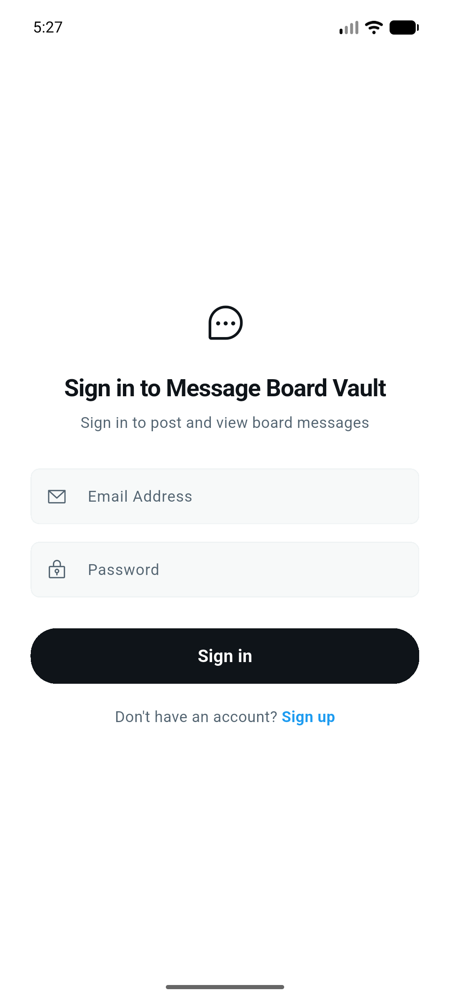 |
